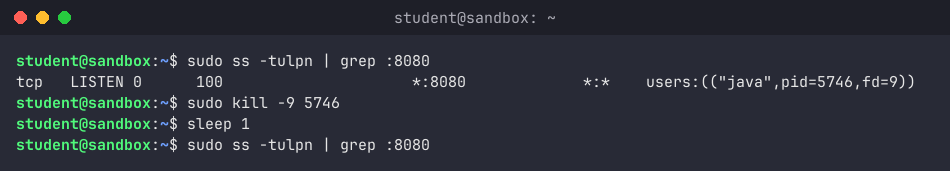
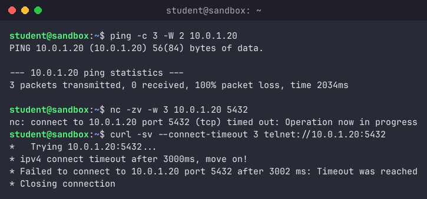

# Network Diagnose - user-service

## Tình huống 1: Trùng cổng 8080 (Address already in use)

```bash
# 1. Find the process listening on 8080
sudo ss -tulpn | grep :8080
# Example output:
# tcp LISTEN 0 100 *:8080 *:* users:(("java",pid=12345,fd=9))

# 2. Kill it by PID
sudo kill -9 12345

# 3. Re-check: no output means the port is free
sudo ss -tulpn | grep :8080
```

| Lệnh | Mục đích |
|------|----------|
| `ss -tulpn` | Liệt kê socket TCP (`-t`), UDP (`-u`), đang lắng nghe (`-l`), kèm tiến trình/PID (`-p`), hiển thị số cổng thay vì tên (`-n`). Cần `sudo` để thấy PID của tiến trình user khác. |
| `grep :8080` | Lọc dòng chứa cổng 8080 |
| `kill -9 <PID>` | Gửi SIGKILL, buộc tiến trình dừng ngay để giải phóng cổng. (Nên thử `kill <PID>` trước để tiến trình tắt êm.) |

Có thể dùng thay thế: `sudo lsof -i :8080` hoặc `sudo fuser -k 8080/tcp`.

## Tình huống 2: Không kết nối được PostgreSQL tại 10.0.1.20

```bash
# 1. Physical/network reachability
ping -c 4 10.0.1.20

# 2. Is port 5432 open?
nc -zv 10.0.1.20 5432
# or
curl -v telnet://10.0.1.20:5432

# 3. (Optional) Where does the route break?
traceroute 10.0.1.20
```

| Lệnh | Mục đích |
|------|----------|
| `ping -c 4 10.0.1.20` | Gửi 4 gói ICMP kiểm tra máy DB có liên lạc được không (đường truyền mạng). |
| `nc -zv 10.0.1.20 5432` | Thử mở kết nối TCP tới cổng 5432 mà không gửi dữ liệu (`-z`), in chi tiết (`-v`). `succeeded` = cổng mở; `Connection refused` = máy sống nhưng PostgreSQL không lắng nghe; timeout = bị firewall chặn. |
| `curl -v telnet://10.0.1.20:5432` | Cách khác để thử kết nối TCP; `Connected to` nghĩa là cổng mở. |
| `traceroute 10.0.1.20` | Xem gói tin bị rớt ở hop nào. |

### Cách đọc kết quả

| ping | nc 5432 | Kết luận |
|------|---------|----------|
| OK | succeeded | Mạng và cổng ổn → kiểm tra cấu hình app (URL, user/password, `pg_hba.conf`) |
| OK | refused | PostgreSQL chưa chạy hoặc `listen_addresses` chỉ là localhost |
| OK | timeout | Firewall / Security Group chặn 5432 |
| Fail | — | Lỗi mạng/định tuyến, hoặc máy DB tắt (lưu ý: một số máy chặn ICMP) |

Ảnh chụp PID chiếm cổng 8080: [port_fix.png](port_fix.png)



## Kết quả kiểm tra DB 10.0.1.20

`ping` mất 100% gói và `nc`/`curl` đều timeout → máy 10.0.1.20 không liên lạc được từ sandbox (sai mạng/định tuyến hoặc firewall chặn), chưa phải lỗi cấu hình PostgreSQL.


